<p align="center">
  
</p>

<h1 align="center">LOOZ · لوز</h1>

<p align="center">
  <b>An AI + IoT assistant that helps Tunisian almond farmers protect their trees, in simple Arabic or French.</b><br>
  IEEE AOTN Challenge · TSYP 14 · Team <b>HRIGA</b> · IEEE ESPRIT Student Branch
</p>

## The problem

Almond orchards in central and southern Tunisia suffer from drought, heat waves and spring frost at bloom.
Farmers usually see the damage too late, advice is hard to reach, and many farmers read with difficulty.

**LOOZ** puts sensor nodes in each zone of the orchard. Machine-learning models read the sensors and tell the
farmer, in plain Tunisian Derja or French, which zone has a problem, why, and the one thing to do now. The app also
offers photo diagnosis, a voice assistant and a community with verified experts.

<table>
  <tr>
    <td align="center">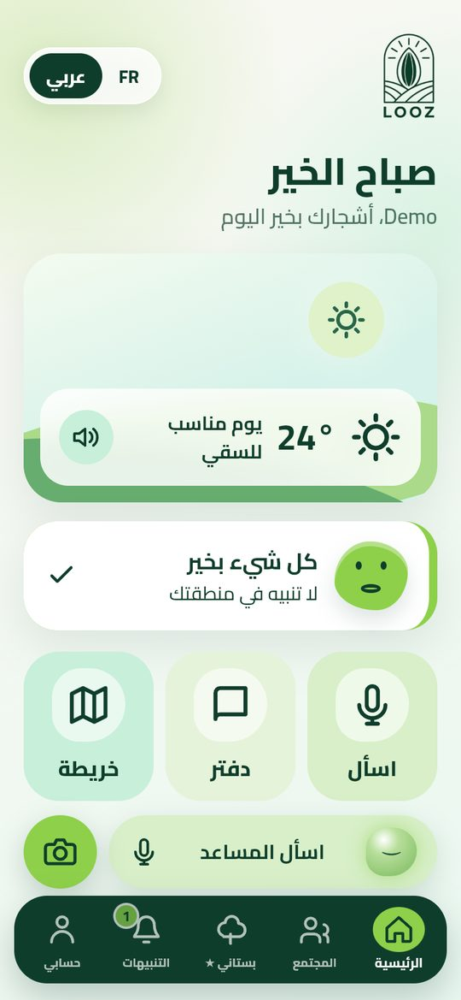<br><sub>Home (AR)</sub></td>
    <td align="center">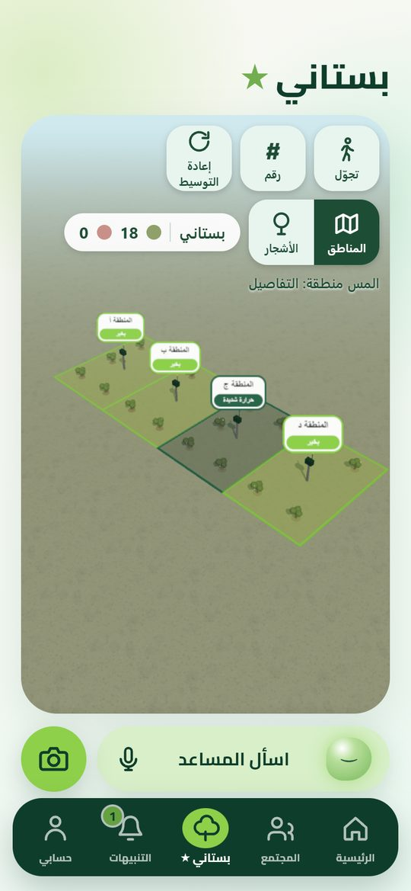<br><sub>3D orchard, live zone states</sub></td>
    <td align="center">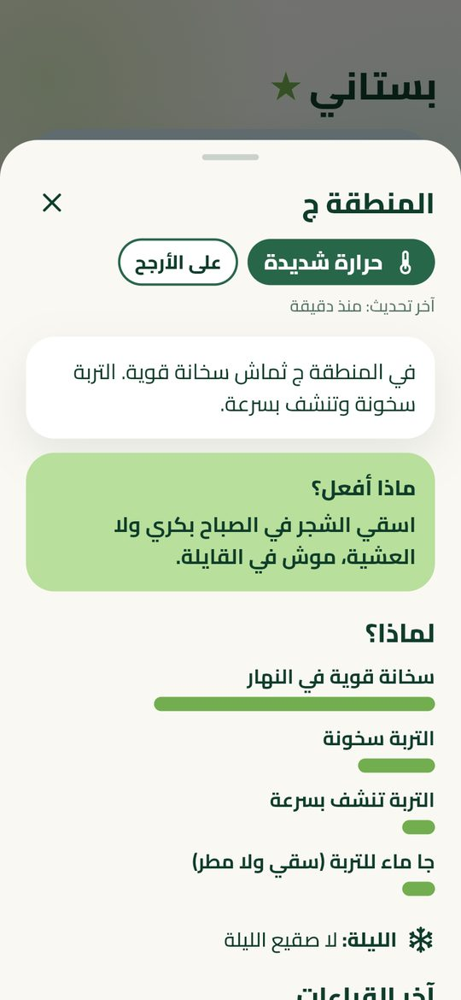<br><sub>Zone panel: why + what to do (Derja)</sub></td>
    <td align="center">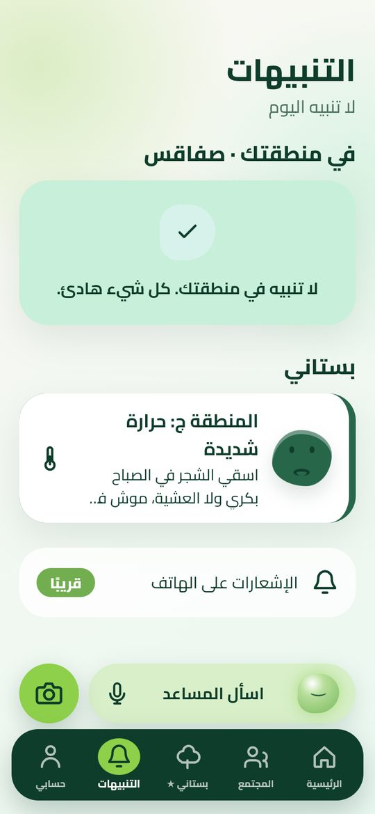<br><sub>Alerts: region + "بستاني"</sub></td>
  </tr>
  <tr>
    <td align="center">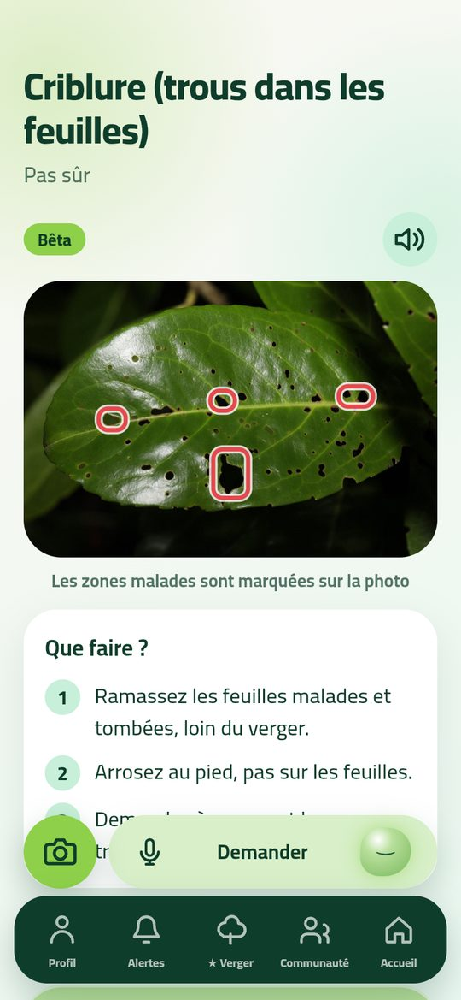<br><sub>Photo diagnosis (FR)</sub></td>
    <td align="center">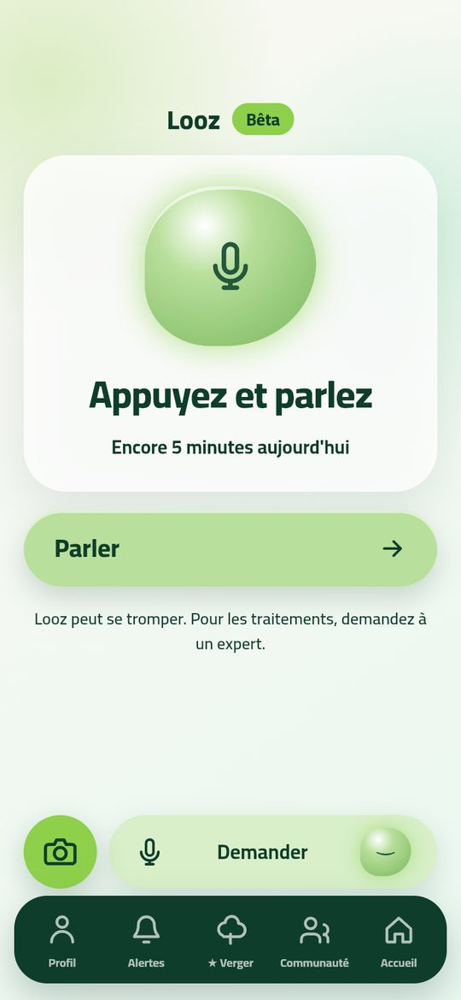<br><sub>Voice assistant "لوز"</sub></td>
    <td align="center">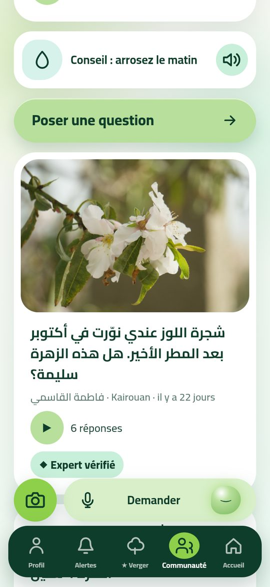<br><sub>Community + verified experts</sub></td>
    <td align="center">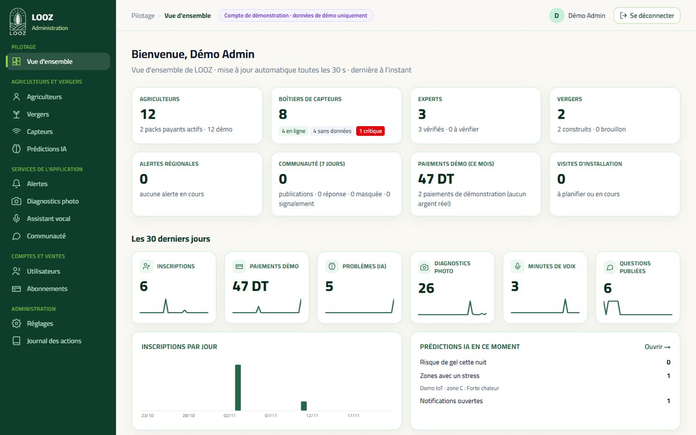<br><sub>Admin dashboard (FR)</sub></td>
  </tr>
</table>

<sub>Screenshots of the running app and dashboard with demo accounts and demo data only. The leaf in the diagnosis
screenshot is a CC0 photo from iNaturalist.</sub>

### The sensor node prototype

We also built a first physical sensor node. The app and the demo still use the nodes simulated in Node-RED.

<table>
  <tr>
    <td align="center">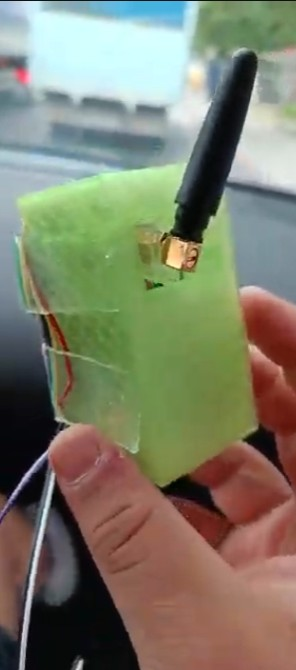<br><sub>First prototype: the node in its case, with its antenna</sub></td>
    <td align="center">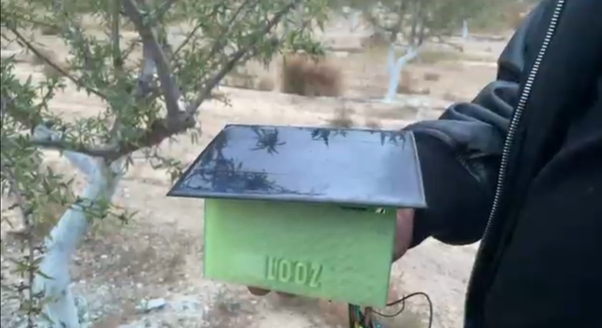<br><sub>The LOOZ node with its solar panel, in an almond orchard</sub></td>
  </tr>
</table>

## Features

Every screen is fully in **Arabic (right to left, the default) or French**.

- **Community + verified experts**: farmers ask questions with a photo and get answers. Answers from verified
  agronomists carry an "◆ Expert vérifié" badge. Farmers can report bad content.
- **Regional alerts**: frost, heat or disease warnings for the farmer's governorate, with simple steps to follow.
- **Orchard designer + 3D orchard**: the farmer draws the orchard on a grid and cuts it into zones. The orchard is
  then shown in 3D, with each zone coloured by its live state.
- **IoT sensor nodes**: one node per zone measures soil moisture, soil and air temperature, air humidity, light and
  trunk vibration. Node-RED simulates the nodes and acts as the farm gateway.
- **ML predictions**: *frost tonight* (logistic regression) and *tree stress* (LightGBM: water deficit,
  waterlogging, heat, frost damage, root zone). They run every 15 minutes for each zone.
- **Explanations**: the main reasons come from SHAP and are shown as simple bars. Groq writes a short text in
  Tunisian Derja and French. Every text is checked: no numbers, no pesticide doses. If a text fails a check, the
  app shows a fixed template instead.
- **In-app notifications**: a banner when a new problem appears, never repeated. The data is live (Supabase
  Realtime).
- **Photo diagnosis**: Gemini vision marks the sick spots on the leaf. Backups: a second Gemini key, then Groq,
  then Roboflow.
- **Voice assistant "لوز"**: the farmer speaks in Derja or French. It uses Gemini Live and knows the farmer's
  zones and sensor readings.
- **Two packs**: **Free** (community, regional alerts) and **Paid**, at 8 TND per sensor node for 30 days (3D
  orchard, predictions, diagnosis, voice).
- **Admin dashboard** (French): farmers, nodes, ML predictions, community moderation, alerts, subscriptions and
  settings. Every admin action is logged.

## Architecture

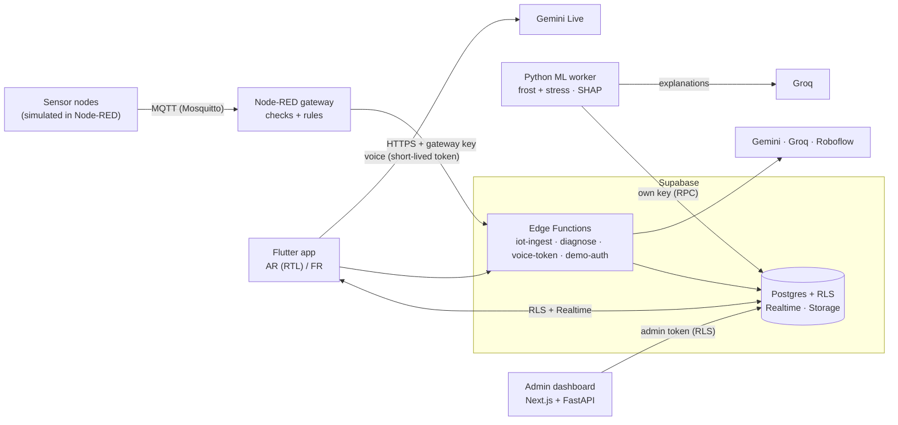

| Part | Folder | What it does |
| --- | --- | --- |
| Flutter app | [`mobile_app/`](mobile_app/) | Farmer and expert app (web, Android, iOS). |
| Supabase | [`supabase/`](supabase/) | Database, RLS on every table, Edge Functions, Realtime. |
| Node-RED + Mosquitto | [`iot/node-red/`](iot/node-red/) | Simulated nodes, gateway checks, sends readings to Supabase. |
| ML worker | [`dashboard/backend/ml/`](dashboard/backend/ml/) | Runs the 2 models in [`AI_modules_time_series/`](AI_modules_time_series/), SHAP, Groq texts. |
| Admin dashboard | [`dashboard/`](dashboard/) | Next.js frontend + FastAPI backend, local only (127.0.0.1). |

## How to run (Windows PowerShell)

### Prerequisites (versions we use)

| Tool | Version |
| --- | --- |
| Flutter (with Dart) | 3.47.7 (Dart 3.13) |
| Node.js + npm | 24.13 / 11.6 |
| Python | 3.13 |
| Mosquitto | 2.1.2 ([mosquitto.org/download](https://mosquitto.org/download/)) |
| Node-RED | 5.0.4 + `@flowfuse/node-red-dashboard` 1.36 |
| Google Chrome and a Supabase project | — |

**Node-RED, first time:**

```powershell
npm install -g --unsafe-perm node-red        # the node-red command
cd iot\node-red
npm install                                  # installs @flowfuse/node-red-dashboard (package.json)
copy .env.example .env                       # then fill it in (see "Environment files")
```

The LOOZ flow is [`iot/node-red/flows.json`](iot/node-red/flows.json). Always start Node-RED from `iot\node-red`
with `node-red -u .`, which uses that folder's `settings.js`, `flows.json` and port 1881.

- **Empty editor or no LOOZ flow?** Node-RED was started without `-u .`, so it opened the default
  `~/.node-red` on port 1880. Stop it and start it again from `iot\node-red`. You can also import the flow: menu
  ☰ › Import › "select a file to import" › `iot/node-red/flows.json` › Import › Deploy.
- **Nodes show "unknown type"?** Run `npm install` in `iot\node-red` and restart.

### Environment files

Copy each `.env.example` and fill in the values. The copies are git-ignored.

| Copy | To | Variables to fill |
| --- | --- | --- |
| `mobile_app/.env.example` | `mobile_app/.env` | `SUPABASE_URL`, `SUPABASE_PUBLISHABLE_KEY` |
| `dashboard/backend/.env.example` | `dashboard/backend/.env` | `SUPABASE_URL`, `SUPABASE_ANON_KEY`, `SUPABASE_SERVICE_ROLE_KEY`, `FRONTEND_URL`, `SUPABASE_IPV4_ONLY`, optional `DEMO_ADMIN_PASSWORD`, ML worker: `ML_WORKER_KEY`, `GROQ_API_KEY` (optional: `ML_POLL_SECONDS`, `ML_GROQ_PER_MINUTE`, `ML_MODELS_DIR`) |
| `dashboard/frontend/.env.example` | `dashboard/frontend/.env.local` | `NEXT_PUBLIC_SUPABASE_URL`, `NEXT_PUBLIC_SUPABASE_ANON_KEY`, `NEXT_PUBLIC_API_URL` |
| `iot/node-red/.env.example` | `iot/node-red/.env` | `LOOZ_INGEST_URL`, `LOOZ_GATEWAY_KEY`, `LOOZ_GATEWAY_CODE` (optional: `PORT`, `LOOZ_BATCH_SECONDS`, `LOOZ_TIME_MODE`, `LOOZ_SCENARIO`) |

### Supabase setup (short)

The full steps, with each file's expected check line, are in [PROJECT_STATUS.md §7](PROJECT_STATUS.md).

1. **SQL Editor**: run these in order: `supabase/looz_schema.sql`, `supabase/looz_policies.sql`, then
   `supabase/migrations/002_zones_and_nodes.sql` … `019_ml_predictions.sql`, one by one in number order
   (002 → 019). Each file ends with a check line.
2. **Optional demo data** in `supabase/seed/`: `orchard_demo.sql`, `community_demo.sql`, `iot_demo_farmer.sql`
   (its result line gives the gateway key for `LOOZ_GATEWAY_KEY`) and `demo_admin.sql` (for "Connexion démo").
   When to run each: §7.
3. **Keys**:
   - ML worker: `select public.ml_worker_new_key('ML-01');` → put the result in `ML_WORKER_KEY` in
     `dashboard/backend/.env`.
   - A new gateway key: `select public.iot_gateway_new_key('GW-01');` → put the result in `LOOZ_GATEWAY_KEY` in
     `iot/node-red/.env`.
4. **Edge Functions** (Deploy a new function › Via Editor › paste `supabase/functions/<name>/index.ts`):

| Function | Verify JWT | Secrets (names only) |
| --- | --- | --- |
| `demo-auth` | **OFF** | — |
| `iot-ingest` | **OFF** | — (it checks the gateway key itself) |
| `diagnose` | **ON** | `GEMINI_VISION_API_KEY`, `ROBOFLOW_API_KEY`; optional `GEMINI_API_KEY2`, `GROQ_API_KEY`, `ROBOFLOW_MODEL` |
| `voice-token` | **ON** | `GEMINI_API_KEY` |

### Running: one PowerShell window per step, in this order

Run these from the repository root. The first time, a blocked `Activate.ps1` is fixed with
`Set-ExecutionPolicy -Scope CurrentUser RemoteSigned`.

**1. Mosquitto (MQTT broker)**: skip this if it already runs as a Windows service.
```powershell
& "C:\Program Files\mosquitto\mosquitto.exe" -v
```
✔ `Opening ipv4 listen socket on port 1883.`

**2. Node-RED (farm gateway + simulated nodes)**
```powershell
cd iot\node-red
node-red -u .
```
✔ `Server now running at http://127.0.0.1:1881/`. Its dashboard, http://127.0.0.1:1881/dashboard, shows
"Envoi à Supabase : ✓ … acceptée(s)".

**3. Admin backend (FastAPI)**
```powershell
cd dashboard\backend
python -m venv .venv                                        # first time only
.venv\Scripts\Activate.ps1
pip install -r requirements.txt -r requirements-ml.txt     # first time only
uvicorn app.main:app --reload --host 127.0.0.1 --port 8000
```
✔ `Uvicorn running on http://127.0.0.1:8000` (API docs: http://127.0.0.1:8000/docs)

**4. Admin frontend (Next.js)**
```powershell
cd dashboard\frontend
npm install                                                 # first time only
npm run dev
```
✔ `Local: http://127.0.0.1:3000`. Open it and log in as an admin, or with "Connexion démo".

**5. ML worker (predictions + explanations)**
```powershell
cd dashboard\backend
.venv\Scripts\Activate.ps1
python -m ml.worker
```
✔ `ML worker started (models …)`, then every few seconds `round: N jobs, N predictions, saved …`

**6. Flutter app (in Chrome)**
```powershell
cd mobile_app
flutter pub get
flutter run -d chrome --dart-define-from-file=.env
```
✔ Chrome opens the start screen ("عربي | FR", "إنشاء حساب", "تسجيل الدخول").

## Demo

> ⚠ **These are demo modes. Turn them off before a real launch** (how: [PROJECT_STATUS.md §5, §9, §10](PROJECT_STATUS.md)).

- **Demo login**: any +216 number and **any 6-digit code** (no SMS). This is the setting
  `app_settings.demo_login_enabled`. Seeded accounts:
  - **22 777 001**: paid farmer with the Node-RED orchard: live sensors, predictions, alerts.
  - **22 123 456**: paid farmer with a demo orchard.
  - **22 123 457**: free farmer, who sees the locked screens.
  - **22 123 458**: expert.
- **"Connexion démo"** on the admin dashboard: a one-click demo admin that sees demo data only. It needs
  `DEMO_ADMIN_PASSWORD` in `dashboard/backend/.env` and `demo_admin.sql`.
- **Frost-night scenario**: on Node-RED's dashboard, turn on **"Scénario : nuit de gel (floraison)"**, or set
  `LOOZ_SCENARIO=frost`. Within 2–3 minutes the app shows a frost banner for the low zone. The simulated clock only
  moves forward.
- **Demo payment**: no money moves and the card is never stored. The test card **4000 0000 0000 0002** is always
  refused. Any other well-formed card is accepted.

## Security

- Secrets live only in git-ignored `.env` files and in Supabase Edge Function secrets. Never commit a `.env` file.
- Every table has Row Level Security. The app and the admin frontend only hold public keys. The `service_role` key
  stays in the backend `.env`, on 127.0.0.1.
- The Node-RED gateway and the ML worker each use their own key. The database stores only a hash of each.

## Documentation

- [PROJECT_STATUS.md](PROJECT_STATUS.md): everything in detail (status, setup, tests, demo, admin how-tos).
- [docs/ml_features.md](docs/ml_features.md): how the 148 model features are computed from the sensors.
- [docs/milestone3_own_model.md](docs/milestone3_own_model.md): comparison of the photo-diagnosis models, and the
  plan for our own model.
- [dashboard/README.md](dashboard/README.md), [iot/node-red/README.md](iot/node-red/README.md),
  [mobile_app/SCREENS_CHECKLIST.md](mobile_app/SCREENS_CHECKLIST.md)
- More screenshots: [docs/screenshots/](docs/screenshots/)
